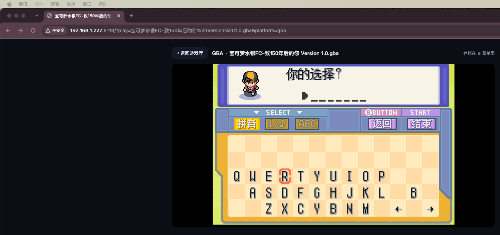

# 🕹️ 网页游戏厅

> 一个 Python 文件 + 一个 HTML 文件，把浏览器变成十合一怀旧游戏机。



FC / SFC / GB / GBA / 世嘉MD / N64 / NDS / PS1 / PSP / 街机，ROM 在网页上传、浏览器直接玩、存档跟着浏览器走。模拟全部在浏览器端（WebAssembly）完成，服务端只是一个零依赖的静态文件服务器，树莓派都能带得动。

## 特性

- **十平台**：FC、SFC、GB/GBC、GBA、世嘉MD、N64、NDS、PS1、PSP、街机（FB Neo）
- **零依赖**：`server.py` 单文件，只用 Python 3 标准库，clone 下来就能跑
- **网页管库**：拖拽 / 多选上传 ROM，按扩展名自动识别平台（也可手动指定），单文件上限 500MB
- **浏览器存档**：即时存档（save state）和电池存档（.sav）都保存在浏览器里，下次打开同一游戏直接续玩
- **手柄 & 手机**：蓝牙 / USB 手柄即插即用，手机浏览器自动显示虚拟按键
- **线程化 PSP 内核**：服务端自动下发 COOP/COEP 响应头，ppsspp 线程内核开箱即用（SharedArrayBuffer）
- **PS1 多轨镜像**：`cue/chd/iso/pbp` 在库列表里自动隐藏同名 `bin/img` 轨道文件，一个游戏一张卡片

## 快速开始

```bash
git clone https://github.com/dendiwu/web-game-arcade.git
cd web-game-arcade

# 1. 下载 EmulatorJS 运行时（约 100MB wasm 核心，只需一次）
./scripts/setup-data.sh

# 2. 启动（默认端口 8188，可用环境变量 PORT 修改）
python3 server.py
```

浏览器打开 `http://<主机IP>:8188`，把 ROM 拖进去就能玩。

> 不想跑脚本？到 [EmulatorJS Releases](https://github.com/EmulatorJS/EmulatorJS/releases) 手动下载 zip（本项目基于 4.2.3），把解压出的 `data/` 目录放到项目根目录即可。

### 支持的平台与格式

| 平台 | 扩展名 |
|---|---|
| FC 红白机 | `.nes` `.fds` `.zip` `.7z` |
| SFC 超任 | `.sfc` `.smc` `.zip` `.7z` |
| GB / GBC | `.gb` `.gbc` `.zip` `.7z` |
| GBA | `.gba` `.zip` `.7z` |
| 世嘉 MD | `.md` `.gen` `.bin` `.zip` `.7z` |
| N64 | `.n64` `.z64` `.v64` `.zip` `.7z` |
| NDS | `.nds` `.zip` `.7z` |
| PS1 | `.chd` `.cue` `.bin` `.pbp` `.img` `.iso` `.zip` `.7z` |
| PSP | `.iso` `.cso` `.pbp` `.chd` `.zip` `.7z` |
| 街机 | `.zip` `.7z` |

PS1 多文件镜像（`.cue` + `.bin`）请打包成一个 zip 再上传。

### 键盘默认按键

| 键 | 功能 |
|---|---|
| 方向键 | 十字键 |
| <kbd>X</kbd> / <kbd>Z</kbd> | A / B |
| <kbd>A</kbd> / <kbd>S</kbd> | L / R |
| <kbd>Enter</kbd> | Start |
| <kbd>右Shift</kbd> | Select |

可在游戏内菜单（画面下方工具条 ☰）里改键、设置金手指、快进、存读档。

## 架构

```
浏览器                          server.py（纯 stdlib）
┌────────────────────┐          ┌──────────────────────┐
│ index.html 游戏厅UI │  ←静态─  │  /            静态文件 │
│ EmulatorJS loader   │  ←静态─  │  /data/       模拟核心 │
│ (libretro wasm 核心) │  ←ROM──  │  /roms/<平台>/ ROM库  │
│ 模拟/渲染/存档全在此  │  API──→  │  /api/roms    列表    │
└────────────────────┘          │  /api/upload  上传     │
                                │  /api/roms/…  删除     │
                                │  /health      健康检查 │
                                └──────────────────────┘
```

- **`index.html`**：游戏厅单页。库视图（上传/列表/删除）+ 播放器视图（按平台设置 `EJS_*` 变量后加载 `/data/loader.js`），无框架、无构建。
- **`server.py`**：`ThreadingHTTPServer`，约 200 行。静态文件 + 4 个 REST 接口 + 按平台/扩展名白名单校验 + 路径穿越防护。所有响应自动带 `Cross-Origin-Opener-Policy` / `Cross-Origin-Embedder-Policy`（PSP 线程内核需要）。
- **`data/`**：EmulatorJS 官方运行时（GPL-3.0），不进本仓库，由 setup 脚本下载。
- **模拟核心**：mupen64plus-next、ppsspp、fbneo 等 libretro WASM 编译版，全部在浏览器里跑，服务端零 CPU 负担。

## 部署

### systemd

```ini
# /etc/systemd/system/web-game-arcade.service
[Unit]
Description=Web Game Arcade
After=network.target

[Service]
WorkingDirectory=/opt/web-game-arcade
Environment=PORT=8188
ExecStart=/usr/bin/python3 server.py
Restart=on-failure

[Install]
WantedBy=multi-user.target
```

仓库里的 `deploy.yaml` 是配合自研 auto-deployer 用的（端口自动分配 + 健康检查 + 崩溃自拉起），字段含义一目了然，也可以照着接到你自己的部署工具上。

### ⚠️ 安全提醒

服务**没有任何鉴权**，上传接口等于公开写权限。只在家里内网、Tailscale/WireGuard 之类的私有网络里用，**不要直接暴露到公网**。

## 仓库自带的 ROM

只收录可自由分发的 homebrew：

- `roms/gba/240p测试套件.gba` —— [240p Test Suite](https://junkerhq.net/xrgb/index.php?title=240p_test_suite)（Artemio Uribe 制作，开源显示效果测试工具），正好可以验证模拟器画面/延迟/音画同步是否正常。

其他 ROM 请通过网页自己上传，仓库与作者不分发任何商业游戏。请在合法前提下使用自己拥有的游戏卡带/光盘备份。

## 常见问题

**存档存在哪？** 浏览器的 IndexedDB/localStorage 里。清浏览器数据、换设备、换浏览器都会丢，重要进度请用游戏内菜单导出存档文件备份。

**手机能玩吗？** 能，会自动显示虚拟按键。但 N64 / PSP / NDS 对性能要求高，手机上卡顿属正常，电脑浏览器体验最好。

**为什么启动后是空白页？** 先跑 `./scripts/setup-data.sh` 把 `data/` 下载下来；没有它就没有模拟核心。

## 致谢

- [EmulatorJS](https://github.com/EmulatorJS/EmulatorJS) 及其背后的 libretro / RetroArch 全家（GPL-3.0）
- [240p Test Suite](https://junkerhq.net/xrgb/index.php?title=240p_test_suite) by Artemio Uribe

本项目代码可自由使用；模拟核心与 EmulatorJS 前端遵循其原许可协议。
